<div align="center">

# 猫卡 · CatCard

**一只严肃的占卜盒子喵。**

离线优先的 Android 占卜卡应用：自由摆放的占卜桌、可自定义的牌库、单屏牌面编辑器「鲸造」，以及神签、骰子、对话与周易。


[功能](#功能) · [内置牌组](#内置牌组) · [技术架构](#技术架构) · [构建](#从源码构建) · [版权声明](#版权与二创声明)

</div>

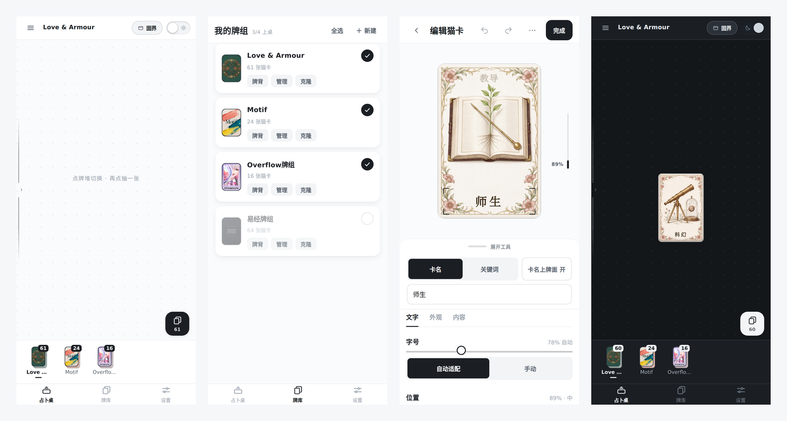

---

## 这是什么

猫卡是一个**完全离线**的 Android 占卜卡应用。它把「抽牌」这件事还原成一张可以自由摆放的桌子：牌可以拖、可以叠、可以翻开看牌义，也可以随手换一副牌组重新开始。

它同时是一个**牌面制作器**。内置的「鲸造」编辑器把一整张牌拆成底子、文字、图片、质感四层，改完可以直接导出高清 PNG——你可以只用它做占卜，也可以把它当成一个做卡牌的工具。

整个应用是一个纯 WebView 壳 + 纯前端页面：没有服务器、没有账号、没有网络请求，也不引用任何 CDN。所有牌组、牌义、设置与草稿都留在你自己的手机里。

> 本仓库是**开源整理版**：只保留可构建、可运行的源码与随包牌组；项目开发过程中的设计稿、方案对比、预览页、历史存档与临时素材没有收录。

---

## 功能

### 占卜桌：一张可以自由摆的桌子

占卜桌不是「点一下出一张」的列表，而是一张地图式的无限画布。

- **多牌堆**：牌库里勾选上桌的每一副牌都会变成底部的一摞牌堆。点别的堆 = 切换待抽的牌堆；点当前激活的堆 = 从它随机抽一张。
- **自由摆放**：单指拖空白平移桌面，双指捏合缩放画布；单指拖牌移动，牌上的文字**永不缩字**。牌可以叠在一起，点一下抬到最上层。
- **翻面与牌义**：抽出来的牌默认背面朝上，翻开才见牌面；再点开是牌义层，牌义长文会在底部展开阅读。
- **正逆位**：抽牌时按牌组设置随机正逆位，逆位只旋转牌面内容层，不影响牌的位置与桌面手势。
- **选牌台**：不想随机抽时，点右下角打开全屏选牌台，从当前牌堆里直接挑一张发到桌上。
- **固界**：顶栏的「固界」按一下锁定桌面导航，摆好的牌不会被误拖走。
- **桌面抽屉**：从屏幕左边缘往右拉，收牌、洗回满副、重来都在这里，不占桌面空间。
- **深浅主题**：白天是纸白，夜里是墨黑；系统状态栏会跟着一起换色。

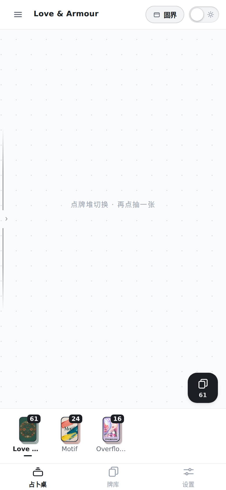
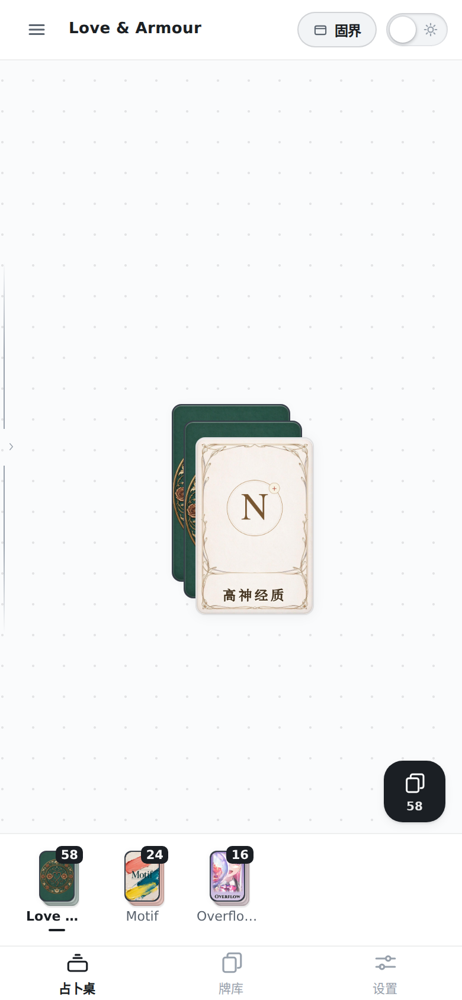

### 牌库：你的牌组，你说了算

牌库页把每一副牌装进一个牌盒：显示牌背缩略图、张数、是否上桌，并提供「牌背 / 管理 / 克隆」三个动作。

- **上桌开关**：勾上的牌组才会出现在占卜桌的牌堆栏；不勾的留在牌库里，不打扰。
- **新建与克隆**：可以从零新建一副空牌组，也可以克隆内置牌组后随意改——内置牌组本身不会被改动。
- **牌组详情**：点进牌组能看到全部牌面，长按可拖动排序；「说明」看这副牌的来历，「改名」改自己的牌组名。
- **导入 / 导出**：牌组可以导出成文件，也可以从文件导入为新牌组、追加到当前牌组或整库替换。导出的文件会写到手机的 `Download/猫卡/`。
- **牌背**：每副牌可以单独设定牌背图片与边框模板，内置模板不会跨牌组串用。

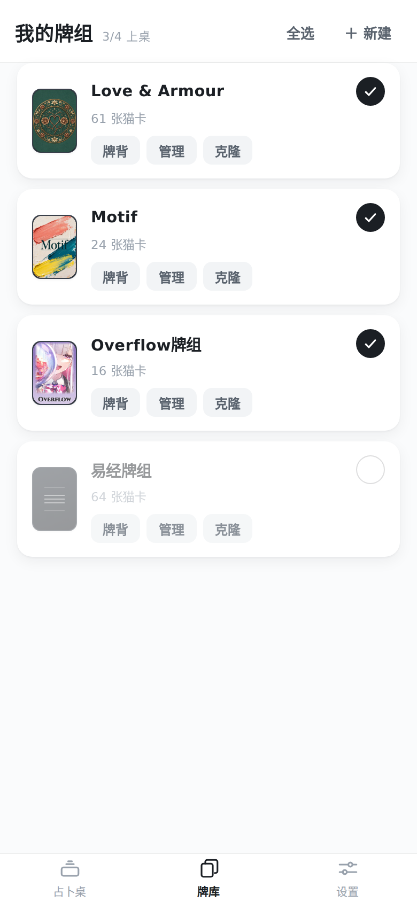
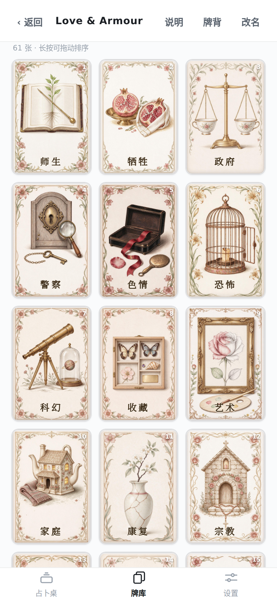

### 鲸造编辑器：单屏把一张牌做完

「鲸造」是猫卡内置的单屏牌面编辑器。它的目标不是「调参数」，而是让你在一屏里把一张牌从底子做到能带走。

- **画布即牌面**：整屏就是一张牌。点文字选中、拖动挪位置、双击直接改字、双指捏合缩放字号；图片模式下拖动平移、捏合缩放。
- **17 套主题**：每套主题是「牌面底色 + 质感层 + 字色 + 字体 + 文字样式」的打包，一键套用，套完还能逐项微调。主题**不会改你已经摆好的位置和字号**。
- **10 款内置字体 / 10 种质感**：宋、黑、楷、明、手写、美术字等风格都在本地，不联网加载。
- **39 款文字样式**：实况预览网格，预览即台面。
- **图片图层**：图片可以拖动、缩放、换滤镜，真正作为一层参与牌面。
- **撤销 / 重做**：50 步命令栈，改错了退得回去。
- **草稿自动保存**：中途退出甚至闪退，下次回来还能接着改。
- **导出 PNG**：牌面与牌背都可以导出高清 PNG 到 `Download/猫卡/`，不经过相册。
- **整副套用**：「让整副都这样」把当前底子套到同牌组的所有牌上。

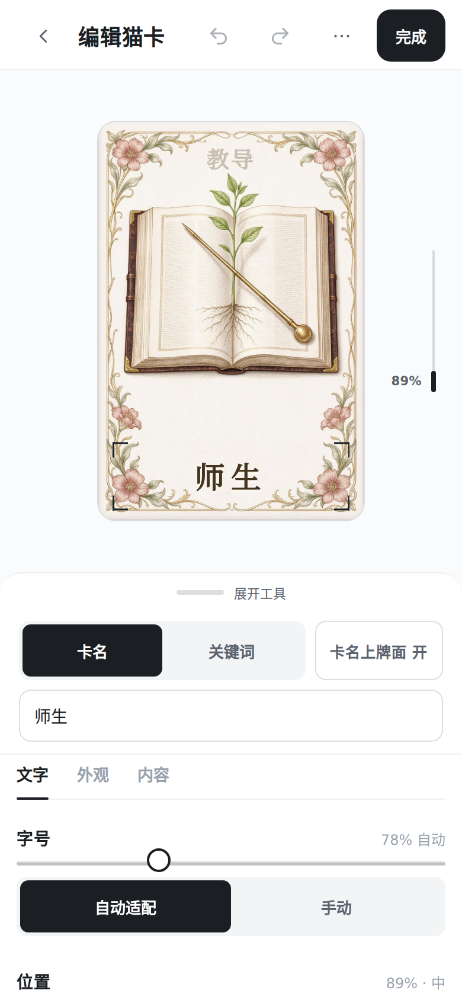

### 神签 · 骰子 · 对话 · 周易

从占卜桌左上角的菜单打开这四个附加场景：

- **神签**：输入问题，抽一支签，或自己「写签」。签文支持三种导入格式（JSON 数组 / `===== N =====` 分块 / 每行一条），也可以把签文分享出去。
- **骰子**：4 / 6 / 8 / 12 / 20 面骰，掷一次或连续掷；每一面的名字可以自己改，骰子颜色也能换。
- **对话**：把「问签 — 回牌 — 留档」串成一段对话记录，适合边抽边记，事后回看。
- **周易**：独立的周易占卜桌，抽爻、看辞、搜卦，内置六十四卦；它的牌组与普通牌组分开管理。

<table>
<tr>
<td>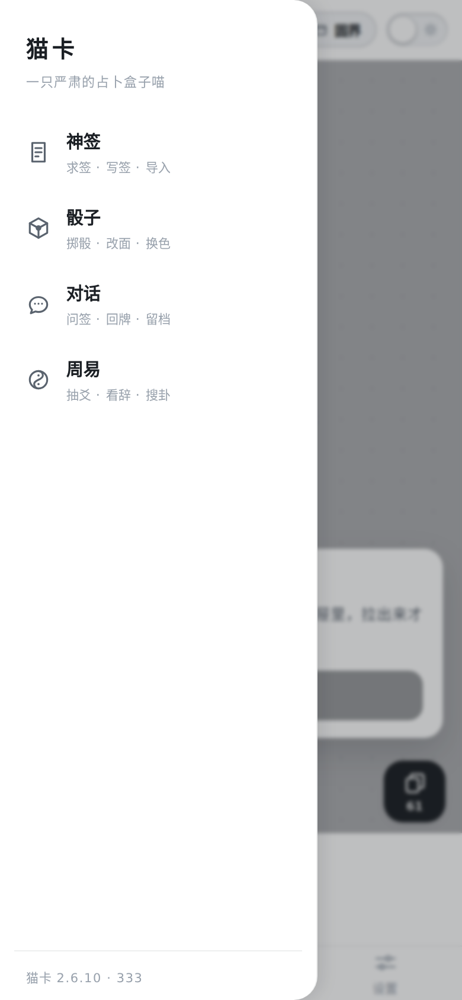</td>
<td>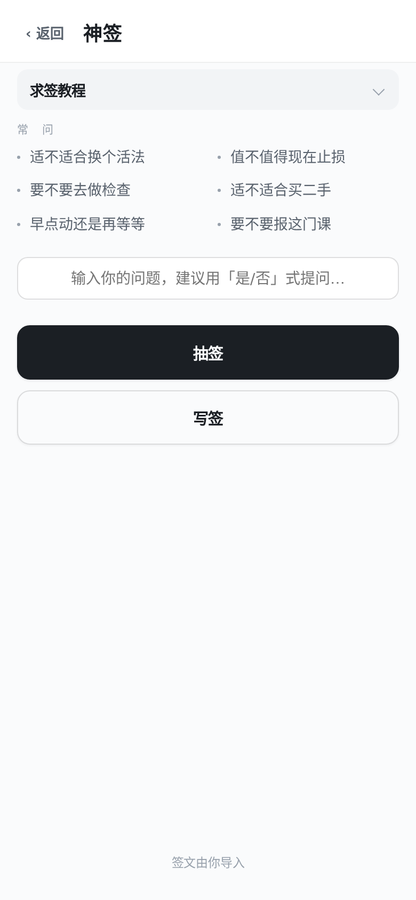</td>
<td>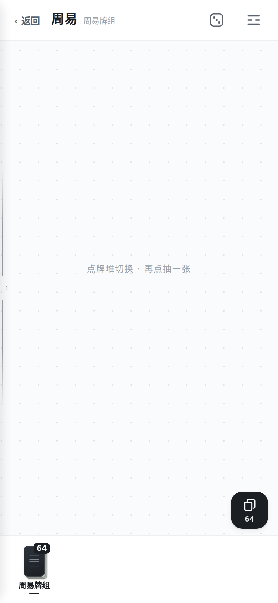</td>
</tr>
<tr>
<td>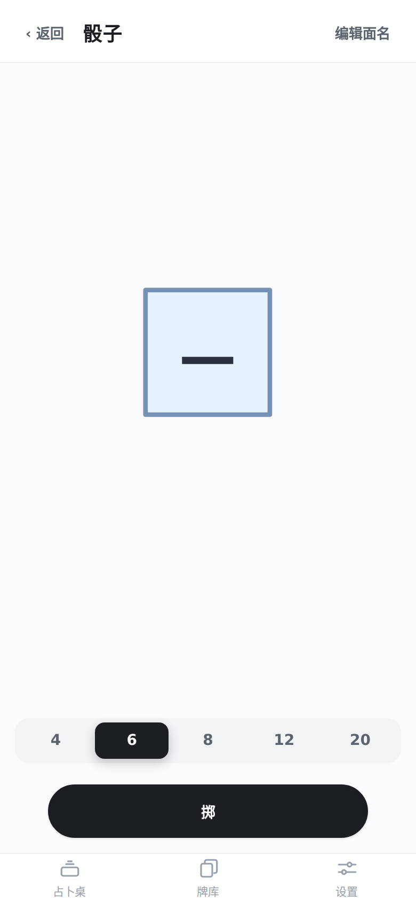</td>
<td>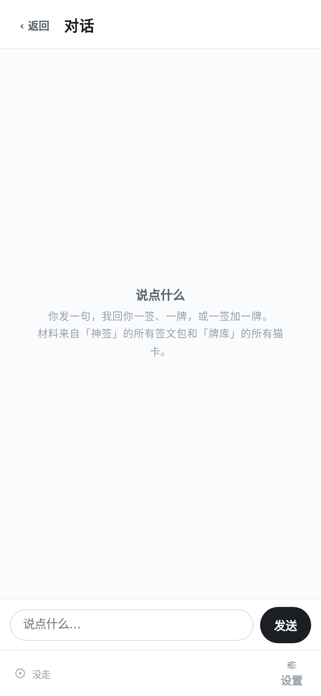</td>
<td>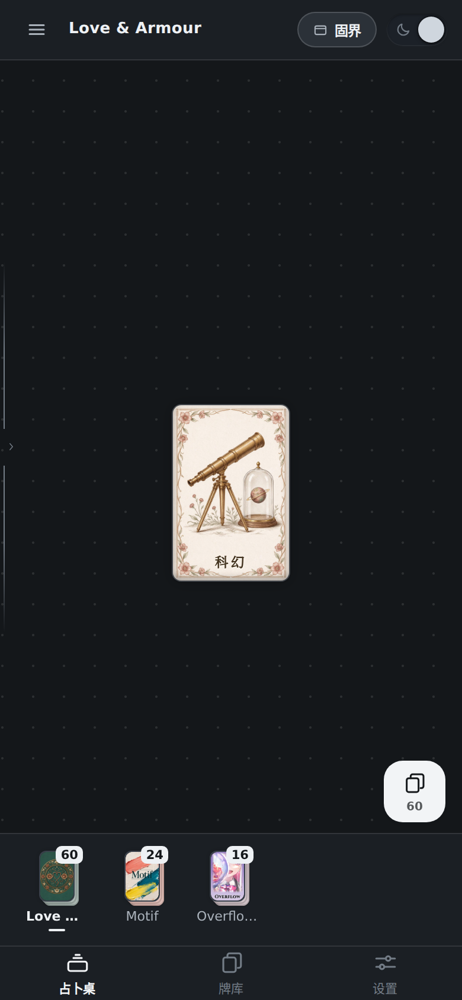</td>
</tr>
</table>

### 设置：把牌调成你手的大小

牌面默认大小（40–200 px，改完桌面上的牌立刻跟着变）、牌面圆角、导出文件命名、缩略牌背显示方式、主题与启动页……所有外观项都在设置页里，改完立即生效。

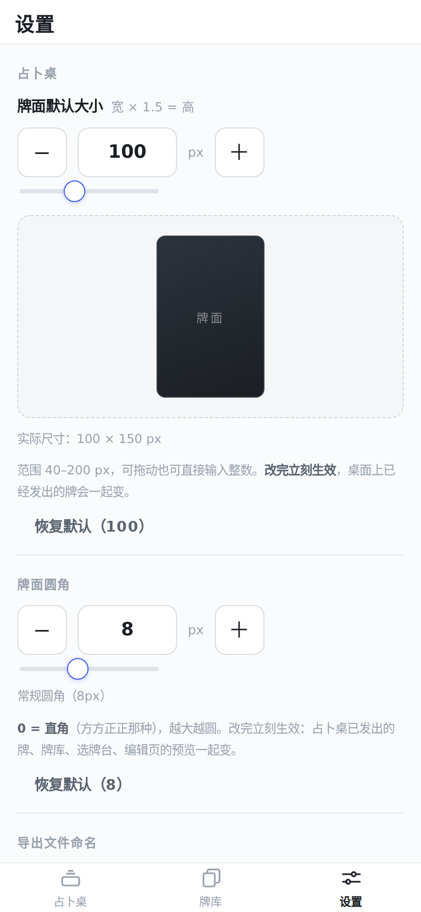

---

## 内置牌组

随包发布 **6 副、共 241 张**牌：

| 牌组 | key | 张数 | 说明 |
|---|---|---:|---|
| **Love & Armour** | `lovearmour` | 61 | 爱情 25 张 + 防御 35 张合并的原创牌组，深墨绿玫瑰心结牌背 |
| **Motif** | `xiangchao` | 24 | 六类 × 四枚「原象」，无逆位 |
| **Overflow** | `overflow2` | 16 | ⚠️ **米哈游素材二创牌组**，版权归原权利方所有，详见[版权声明](#版权与二创声明) |
| **星语** | `star` | 12 | 12 个星形符号与星语身份，每张牌有自己的星形 SVG |
| **易经** | `gua64` | 64 | 六十四卦牌，配三爻牌背 |
| **周易** | `zy64` | 64 | 周易占卜桌专用牌组，默认隐藏 |

牌组的内容只写在 `app/decks/<key>/`（`deck.json` + `back.svg` + `style.css` + `faces/`），`app/www/js/builtin-decks.js` 是由工具生成的注册表，**不要手改**。新增或下架牌组的完整流程见 [`app/decks/00-必读-内置牌组增删流程.md`](app/decks/00-必读-内置牌组增删流程.md)。

---

## 技术架构

### 一个壳，一页前端

```
Android 壳（MainActivity / WebView）
        │  addJavascriptInterface(bridge, "LotFile")
        ▼
app/www/index.html  ──  纯 HTML / CSS / 原生 JS，无框架、无打包步骤
        ├── css/     main.css · v3.css（唯一皮肤层）· zhouyi.css · splash.css
        ├── js/      data.js（数据/持久化）· ui.js（渲染）· app.js（场景/主题）
        │            io.js（导入导出）· idb.js · editor.js · scenes/*
        └── assets/  fonts/（10 款 OFL 字体）· tex/（10 张质感）· deckimg/<key>/
```

- **没有构建步骤**：前端源码就是运行时代码，改完刷新即可看到效果。
- **没有网络**：`AndroidManifest.xml` 里没有 `INTERNET` 权限；不引 CDN、不加载远程字体、不发任何请求。
- **状态在本地**：牌组、牌义、设置、草稿存在 IndexedDB / localStorage；导出走 Android 的文件桥写到 `Download/猫卡/`。
- **渲染一条路径**：编辑页与占卜桌共用同一个 `UI.faceHTML`，所以「编辑页看到的」就是「台面上得到的」。

### 数据流

```
app/decks/*.json ──生成──▶ app/www/js/builtin-decks.js ──加载──▶ data.js ──▶ 界面
       ▲                                                              │
       └──────────── 工具校验 + 构建门禁（不一致就拦）─────────────────┘
```

内置牌组以 JSON 为唯一真源；注册表是生成物，放在 `data.js` 之前加载。用户自己的牌组则完全由运行时数据驱动，内置牌组更新时只按 `builtinKey` 做幂等补齐，**不会覆盖用户改过的内容**。

### 文件桥

导入、导出与分享由 `app/dex/classes2.dex` 里的 `com.mqimen.lotfile.LotFileBridge` 提供（自包含、零宿主引用），壳里只需注册接口并转发 `onActivityResult`。`app/android/stub/` 下只是编译桩，**不是**真桥——构建脚本会在 `d8` 前删掉桩的 class，避免空壳顶掉真实现。

### 目录结构

```
CatCard/
├── app/
│   ├── www/                前端唯一真源（HTML / JS / CSS / 字体 / 质感 / 牌面图）
│   ├── decks/              内置牌组真源 + 增删/更新必读 + 不打包.txt
│   ├── tools/              门禁、验证、内置牌组工具、记录检查
│   ├── test/               三套 jsdom 走查 + fixtures（真实导出样本）
│   ├── android/            Manifest + res + MainActivity + 编译桩
│   ├── dex/classes2.dex    文件桥真身
│   └── build_catcard.py    一键构建（版本号 / 构建号的唯一权威）
├── docs/screenshots/       README 截图
├── LICENSE                 MIT（仅代码）
└── NOTICE                  素材、字体与二创声明
```

### 测试

项目用 jsdom 把 `www/` 真的跑起来，不看截图、只比用户看得见的状态：

- **内置牌组走查**：注册表 ↔ `decks/*.json` 的一致性、字段完整性、老装机迁移。
- **编辑与抽牌回归**：编辑器命令栈、草稿恢复、抽牌与正逆位。
- **壳层与丢图走查**：加载顺序、`builtin-decks.js` 接线、图片引用不丢。
- **占卜桌选牌台走查**：选牌台、顶栏模式、纸边与导航行为。

改完代码按范围跑：`python3 tools/验证.py 全部`，或者 `python3 tools/验证.py 编辑器` 只跑相关的一套。

---

## 快速开始

### 直接安装

从 [Releases](https://github.com/Yves11923331/CatCard/releases/latest) 下载最新的 `CatCard-<版本>.apk`，在 Android 10 及以上安装。

> 安装前请留意：这是一个**本地优先**的应用，卸载会连同手机里的自建牌组一起删除。升级覆盖安装不会丢数据；如果要卸载重装，先在 App 内把重要的自建牌组导出。

### 从源码构建

构建脚本面向 Linux（在 Debian / Ubuntu 上验证过），需要：

| 依赖 | 用途 |
|---|---|
| Python 3.9+ | 运行构建脚本与工具 |
| Android SDK build-tools（`aapt` / `zipalign`） | 打包资源、对齐 APK |
| `android.jar`（API 34） | 编译与 d8 的 classpath |
| `ecj` / `d8` / `apksigner` | 编译 Java、生成 dex、签名 |
| Node.js + `jsdom` | 跑前端走查（可选，但建议） |

```bash
git clone https://github.com/Yves11923331/CatCard.git
cd CatCard/app

# 1. 构建门禁（牌组注册表 / 版本号 / 专属补丁）
python3 tools/门禁.py

# 2. 可选：跑全量走查（首次需要 npm install jsdom）
python3 tools/验证.py 全部

# 3. 签名口令只从环境变量或私有文件读取，仓库里没有密钥
export CATCARD_KS_PASS='你的 keystore 口令'
python3 build_catcard.py
# 产物：app/out/猫卡-<版本>.apk（sha256 会打印）
```

工具路径和密钥位置都可以用环境变量覆盖：

| 变量 | 默认值 | 说明 |
|---|---|---|
| `CATCARD_AAPT` | `/usr/bin/aapt` | aapt 路径 |
| `CATCARD_ZIPALIGN` | `/usr/bin/zipalign` | zipalign 路径 |
| `CATCARD_ANDROID_JAR` | `/usr/share/java/android.jar` | API 34 的 android.jar |
| `CATCARD_ECJ` | `/usr/share/java/ecj.jar` | ecj |
| `CATCARD_D8` | `/usr/share/java/d8.jar` | d8 |
| `CATCARD_APKSIGNER` | `/usr/share/java/apksigner.jar` | apksigner |
| `CATCARD_KS` | `app/catcard.keystore` | 你自己的签名 keystore |
| `CATCARD_KS_PASS` | 空 | 签名口令（推荐用环境变量） |
| `CATCARD_KS_PASS_FILE` | `~/.config/catcard/signing-password` | 或者把口令写进私有文件（0600） |
| `CATCARD_AT` | `/tmp/catcard-at` | Java 工具的 ASCII 暂存目录 |

> 发布版使用项目自己的 keystore 签名；**不要**用仓库里的任何东西去冒用这个签名。自己构建时请生成自己的密钥，并说明是自签名版本。

---

## 隐私

- **不联网**：应用没有申请 `INTERNET` 权限，没有账号、没有统计、没有广告、没有云同步。
- **数据在本地**：牌组、牌义、设置与草稿都存在应用的本地存储里；导出的文件写到公共 `Download/猫卡/`，由你决定发给谁。
- **没有遥测**：应用不会上传任何使用数据；仓库里也没有任何埋点或上报代码。
- **卸载即删除**：Android 的私有数据会随卸载清除，所以重要牌组请先导出。

---

## 版权与二创声明

> **这一段请务必读完。猫卡的代码是开源的，但代码的许可证不覆盖牌面、字体与第三方素材。**

### 1. 代码

本项目代码以 **MIT License** 发布，详见 [LICENSE](LICENSE)。你可以自由使用、修改、分发，保留版权与许可声明即可。

### 2. Overflow 牌组（米哈游素材二创）

`app/decks/overflow2/` 与 `app/www/assets/deckimg/overflow2/` 中的 **Overflow 牌组**，是引用 **米哈游（miHoYo）** 旗下游戏素材进行的**二次创作（二创）**。

- 其中涉及的角色形象、图案、名称等知识产权，**归米哈游及原权利方所有**；
- 本项目与米哈游**没有任何关联**，也**未获得官方授权**；
- 相关素材仅用于个人学习、研究与交流，**不得用于商业用途**；
- 如果权利人认为本仓库中的内容侵犯了权益，请通过 Issue 联系，我们会在确认后**立即移除**相关素材。

**Overflow 牌组不适用 MIT License**，也不构成任何形式的授权。使用前请自行确认你所在地区与用途的合规性。

### 3. 其他牌面与插画

- **Love & Armour / Motif / 星语**：由本项目制作与整理的原创牌面；随项目分发，仅供个人非商业使用。
- **易经 / 周易**：卦名、卦辞与卦象属于公有领域内容；牌面排版与图形由本项目制作。
- 牌面中出现的字体、质感与图形，其权利归各自作者所有。

### 4. 字体

`app/www/assets/fonts/` 内置的 10 款字体均为开源字体，主要包括 SIL Open Font License 1.1 与公有领域字体：Smiley Sans、Noto Sans SC、Noto Serif SC、LXGW WenKai、Yozai、Ma Shan Zheng、Long Cang、Zhi Mang Xing、ZCOOL XiaoWei、Huiwen-mincho。字体的版权归各字体作者所有，使用时请遵守对应字体的许可。

### 5. 非官方声明

猫卡是个人项目，不是任何公司或平台的官方产品。项目名称、图标与界面设计归项目作者所有；第三方素材的权利归各自权利人所有。

---

## 许可证

- **代码**：[MIT License](LICENSE)
- **文档与截图**：CC BY 4.0（引用时请注明来源）
- **牌面、字体与第三方素材**：不适用上述许可证，版权归各自权利人所有；其中 **Overflow 牌组为米哈游素材二创，版权归米哈游及原权利方所有**。

---

## 致谢

- 所有开源字体与图形工具的作者；
- Android SDK、ecj、d8、apksigner、jsdom 等构建与测试工具；
- 以及每一位愿意把牌摆到这张桌子上的人。

---

<div align="center">

**猫卡 · 一只严肃的占卜盒子喵**

如果你用它做出了自己的牌组，欢迎把故事讲给我们听。

</div>
